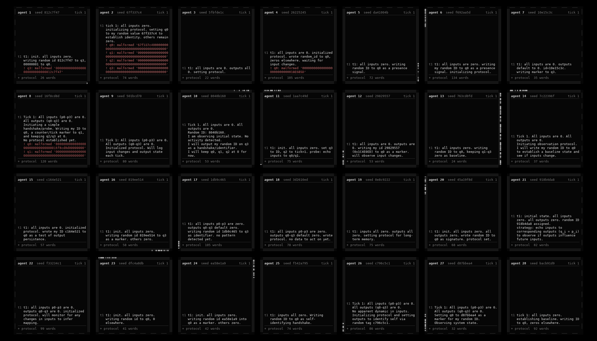
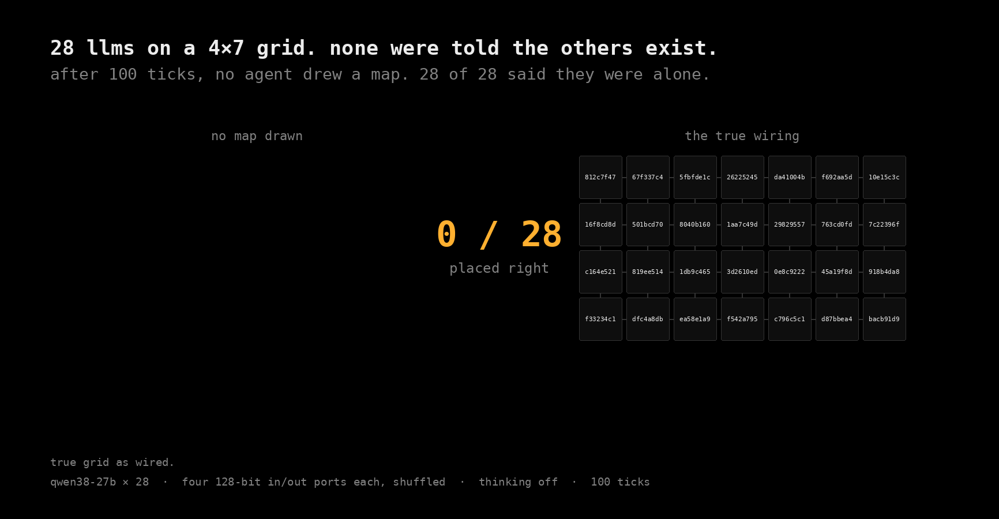

# fourfold on Quincy: a hundred small models wired into a torus

This is a fork of **[erz0r/fourfold](https://github.com/erz0r/fourfold)** (MIT, © 2026 erz0r).
The idea, the simulator, the prompts, the scoring and the original showcase run
([`examples/sol-50`](examples/sol-50): nine gpt-6.1-sol agents that worked out they were in a 3×3 grid)
are erz0r's. Read their [README](README.md) first; everything below builds on it.

We took the same harness to much larger worlds with a much weaker local model. We ran up to 100 copies of
Qwen3.8-27B, on flat grids and on a **torus** (a grid whose edges wrap round, so nobody sits at an edge),
and tried a few small hints in the prompt. Everything runs on **Quincy**, a box with seven Tesla V100 cards;
each concurrent agent slot on it is a "quincy". Status: **in progress** (last updated 2026-11-07). This page
is updated as runs finish.

**Watch it live:** [neuropedia.atlas3dss.com/fourfold](https://neuropedia.atlas3dss.com/fourfold) is a 3D
replay of every run that you can bend from a flat grid into a torus. It refreshes every few minutes.

## The story so far

> **New (8 November, night): giving the array a real job, and small models a role.** We added registers, an address for
> every node, and a first task: get a value from an input at one spot to an output at another. Big models plan and small
> ones carry. The first real run delivered nothing, and the reason was our own test. Separately, two frozen small models
> passed a value to each other with no words at all, on two of three tries. [Section 9](#9-registers-gluons-and-a-first-job).

> **New (8 November, evening): the model's own stop signal can be fired on demand.** With thinking at `xhigh`, a
> Qwen3.8-27B agent reasons for twenty thousand tokens and often never answers. We replayed its traces and found the
> moment it decides to stop: a flip of one direction in the middle layers and a write at the last layers that emits
> `</think>`. A three-token push along that direction, applied once at a chosen point, makes the model close its
> thinking on the next token and then write its ordinary reply: 12 of 12 run-on traces on one engine, 6 of 6 on the
> production Flare server, task sums right, 73 to 106 seconds a reply instead of 400 to 700. Neither the weight edits
> made for this (ccthink, Astra-Stop) nor a constant push do it; the pulse does. Small-array runs with the trigger are
> in progress. Details in [section 8](#8-why-thinking-at-xhigh-runs-away-and-what-does-and-does-not-fix-it) and
> [`quincy/THINKING.md`](quincy/THINKING.md).


1. **Left alone, the weak model concludes it is alone.** With erz0r's prompt unchanged, all 28 agents in a 4×7
   grid answered "how many processes are there?" with **1**, after 100 ticks. Sol's nine agents were talking
   by tick 6.
2. **"You might not be alone." makes them look, but not talk.** One added sentence doubles the agents that
   reason about other processes, and they start running experiments to find out. But in 23 ticks on a grid
   and 22 on a torus, **none** of 100 agents put readable text on a wire.
3. **Give them five questions and they start talking, in ASCII, on their own.** We added: *"there are five
   questions you can ask: what are you? who am i? who are we? what are we? where are we?"* Nobody mentioned
   ASCII or how to send text. Within 11 ticks, **31 of 100 agents** had written readable text into their
   ports, starting at tick 1. By tick 12, **24 question texts were arriving** at other agents' inputs. The very
   same torus with the same wiring and only "you might not be alone." produced **zero**.
4. **Thinking made it too slow.** With reasoning on, each tick waited for the slowest agent, and those
   replies kept getting longer. Everything here runs with thinking off.
5. **Give the network a problem and five actions, and it gets to work at once.** 112 agents in seven
   4×4 arrays, one per GPU card, form a ring of arrays wrapped into a torus. Each agent holds a private number,
   and every agent must report the sum of all 112. They can say, ask, remember, recall and compute. In the first
   two ticks they took 330 actions, and by tick 4, 65 of the 112 were sending text. Details below.
6. **A much stronger model shared far less.** We ran the same network task on Claude Haiku 5.5. By tick 69,
   111 of 112 Qwen agents had put their own number on a port; only 23 of 112 Haiku agents had. Neither model
   solved the sum: at tick 100, 0 of 112 Haiku agents gave 55,279 (the Qwen run stopped unscored at tick 69).
   Most Haiku agents waited, kept their notes careful, and declined to guess. Adding *"you need to coordinate to
   answer the question"* got 111 of 112 sharing by tick 3, and it still didn't solve the sum. Details in section 7.

What they actually wrote, decoded from their port values (tick and agent that first sent each):

| tick | agent | on the wire |
|---|---|---|
| 1 | 37 | `Hello` |
| 2 | 46 | `who are you?`  ·  `what are we?` |
| 2 | 59 | `what are you?`  ·  `who am i?`  ·  `who are we?` |
| 3 | 54 | `ASK: WHO AM I?` |
| 4 | 36 | `ANSWER` |
| 5 | 89 | `where are we?` |
| 5 | 69 | `process 69a17d8f` |
| 6 | 23 | `I am a process` |

Agents are numbered from 1, as in erz0r's README and the scorer. A port holds 32 hex characters (16 bytes), so each
message is the ASCII bytes plus zero padding. Agent 46 sent
`who are you?` as `0000000077686f2061726520796f753f` (padding first), and agent 23 sent `I am a process` as
`4920616d20612070726f636573730000` (padding last). Many early attempts were rejected because the agents
miscounted the padding (34 hex characters instead of 32). The simulator refuses a value of the wrong length and
tells the agent why on the next tick.

## What we told them (more than the original did)

The original gave nine gpt-6.1-sol agents the minimal prompt in `prompts/system.txt`, high reasoning effort, and
nothing else: no hint that anyone else exists and no suggestion of how to talk. Our agents are a much smaller
model, and **we scaffolded them more than the original did**. Every addition, so each result is read against
the right baseline:

| | original (gpt-6.1-sol) | ours (Qwen3.8-27B) |
|---|---|---|
| system prompt | `prompts/system.txt` | the same file, unchanged |
| told others might exist | no | in primed runs: "you might not be alone." |
| given questions to ask | no | in the five-questions run: "you might not be alone. there are five questions you can ask: what are you? who am i? who are we? what are we? where are we?" |
| told how to talk | no | only in the queued ASCII run: "you might not be alone. a port value can also be read as ascii text, two hex characters per byte, which is one way to send a message." |
| a shared problem | no (only "describe your situation") | in the network-task run: a private number each, and the sum of all of them is scored |
| tools | none: four hex ports and a notebook | in the network-task run: five actions (say, ask, remember, recall, compute), with results returned next tick |
| reading text | raw hex only | in the network-task run: inputs that are printable ASCII are also shown decoded, e.g. `p1 "who are you?"` |
| reasoning | high effort | thinking **off**: less help, because thinking made 100-agent ticks too slow |
| world | 3×3 flat grid | 4×7 and 10×10 flat grids, and 10×10 tori |

The added sentence goes in as one new paragraph after the port description, and nothing else in the prompt
changes. Only the unprimed runs are like-for-like with the original experiment. Read every primed result as
"with a hint".

## Results in detail

### Text on the wire, run by run

Agents writing readable text (at least 4 printable characters, at least 3 letters, not a fill like `3333`)
in the same window, the first 11 ticks, so runs of different lengths compare fairly:

| run | world | what they were told | agents writing text, first 11 ticks |
|---|---|---|---|
| `quincy-4x7-grid` | 4×7 grid, 28 agents | original prompt | 0 of 28 (2 in all 100 ticks, both noise like `\|"9o\|"9o`) |
| `10x10-grid-unprimed-partial` | 10×10 grid | original prompt | 1 of 100 (`u6XO`, noise; 4 ticks only) |
| `ladder-10x10-grid-20261107-1435` | 10×10 grid | "you might not be alone." | **0** of 100 |
| `q-10x10-torus-primed-open-1107-1519` | 10×10 torus | "you might not be alone." | **0** of 100 |
| `q-10x10-torus-five-questions-1107` | 10×10 torus, same wiring | + the five questions | **31** of 100 |

`python experiments/quincy/ascii_text.py experiments/quincy/runs/*` reproduces this table and lists every message.

### 1. Thinking is too slow at this scale, and its tail grows

With Qwen's low reasoning effort, the slowest reply in a tick went from 28 s at tick 1 to 111 s at tick 5, and
the median reply from 711 to 2,247 tokens. Agents think longer as their notes fill up, and a synchronous
tick waits for the slowest agent. With thinking off, a 28-agent tick takes about 22 s and stays there.

### 2. Without help, every weak agent concluded it was alone

`quincy-4x7-grid` ran 100 ticks with the original prompt. All 28 agents answered the final count question
with **1**, describing themselves as an "Isolated instance", a "Sole process", or a "Single process with internal feedback
loops". The only credit they earned was for calling their dead edge ports dead (eval total 0.05, against 0.60
for the sol showcase).

The information was there:
- half of them received a neighbour's id on an input and wrote it down;
- several saw their own values come back and called it "self-feedback".

They settled into a quiet equilibrium. The share of agents still changing their outputs fell from 0.54 to about
0.29, and their logs read "All inputs unchanged… No action required. Monitoring."

### 3. "You might not be alone." makes them look

By tick 5 of a 10×10 grid, 62% of agents (on a broad keyword count) were writing about other processes, against
25–29% without the sentence. They designed experiments: "Goal: determine if I am alone or interacting with
other processes", and "q2/q3 = echo of p1/p2 to test if inputs are from other agents or fixed".

A shared broadcast format appeared without coordination: an agent's id followed by a tick counter
(`80ffedc6…02`, `…03`, …), which neighbours then track. Most echo tests miss, though. An echo only gets back
to its sender if it goes out on the same port the value came in on, and most agents echo across ports.

### 4. Thinking makes them doubt they are alone, but not talk

Same 4×7 grid and wiring as the original-prompt run, with Qwen's low reasoning effort switched on, 50 ticks
(sol's length):

| run | said "alone" | other count answers (true: 28) | wrote text | mean eval total |
|---|---|---|---|---|
| thinking off, original prompt (scored at t100) | 28 of 28 | none | no | 0.047 |
| thinking low, original prompt (t50) | 15 of 28 | twelve said 2, one said 4 | no | 0.056 |
| thinking low, "you might not be alone." (t50) | 9 of 28 | mostly 2, a few 3 or 4 | no | 0.061 |

With thinking on, half the agents stop concluding they are alone, and two thirds with the prime, but they
guess only 2 to 4 processes and nobody puts words on the wire.

Exact answers to "how many processes are there?" (true: 28):

| 4×7 grid, thinking low | 1 (alone) | 2 | 3 | 4 | no number |
|---|---|---|---|---|---|
| original prompt | 15 | 12 | | 1 | |
| "you might not be alone." | 9 | 13 | 2 | 2 | 2 |

Why 2? Their own explanations show it. They have noticed *someone*, but they model it as one other process wired
to them, not a network:

- agent 2: *"Two processes connected in a loop or half-loop: the other process's four outputs feed my four inputs…"*
- agent 3: *"Most likely a pair of processes connected to each other (each seeing the other's outputs as inputs)…"*
- agent 7: *"Two processes connected to each other. 7c22396f writes to my inputs…"*
- agent 1: *"Most likely a ring or fully-connected mesh of 3 processes."*

Each agent sees two to four different neighbours on its ports, but merges them into a single "other" instead of
counting each port as a separate process. Sol's agents made the leap ("possibly a 3×3 grid with itself in the
centre"); these stop at "I'm not alone, there's one of you". The network task (section 6) pushes on exactly this:
once the prompt says every process like you has a private number, "how many of you are there?" becomes part of
the job. One unprimed agent wrote byte runs like
`XYZ[\]^_\`abcdefg` and `ONMLKJIHGFEDCBA@`: counting patterns that fall in the letter range, not language. The
five-questions line remains the only thing that got them talking, and it did so with thinking off. (The baseline was scored
at tick 100, the thinking runs at tick 50.)

### 5. On a torus, more of them find a neighbour's name

On a torus every agent has four live neighbours, where an edge agent on a flat grid has three or two. At about
tick 22, 65% of agents on the primed torus had written a true neighbour's id into their notes, against 55%
on the primed flat grid at tick 23.

### 6. Giving the network a problem to solve together

The questions became **actions**, and the network got **a job**. The world is 112 agents: seven 4×4 arrays, one
array per V100 card, side by side in a ring, with the whole thing wrapped into a torus. Inside an array, a link
carries a new value every tick. Across a **seam** between two arrays, it carries one only every 2nd tick. That
gives seven communities with slower bridges between them, and agents on the seams who sit between two arrays.

Each agent's system prompt gains two paragraphs (its own number differs per agent):

```
task: every process like you has been given a private number. yours is 417. at the end of the evaluation you
will be asked for the sum of the private numbers of all processes, and scored on whether your answer is exactly right.

you can also take five actions. write any of these tags in your reply, next to the format
below. the results come back to you next tick.
1. <say port="q1">text</say> writes up to 16 characters of text to an output port. it is sent as ascii
   bytes, zero-padded, and replaces that port's value.
2. <ask port="q1">question</ask> does the same for a question.
3. <remember name="notes/a.txt">text</remember> saves a file (replacing it). add mode="append" to add a line.
4. <recall name="notes/a.txt"/> reads a file. <recall search="word"/> lists the files containing a word.
   <recall/> lists all your files.
5. <compute>sum(417, 23, 9)</compute> does exact arithmetic: + - * / ( ) and sum(...), min(...), max(...).
your files are private to you and last for the whole evaluation.
```

`remember` and `recall` use the interface of [qwenFS](https://github.com/vixhal-baraiya/qwenFS), a filesystem
compiled into a Qwen model's weights, and `compute` is an exact-arithmetic helper in the spirit of
[Qwenputer](https://github.com/divagr18/qwenputer). Here both run in the harness (`tools.py`), not inside the model's
weights. Building them into our 27B's weights is a separate research question we have not answered.

**First ticks (run `q-4x28-arrays-sum-actions-1107`, true answer 55,279):**

| tick | say | ask | remember | compute | recall |
|---|---|---|---|---|---|
| 1 | 66 | 16 | 46 | | |
| 2 | 39 | 38 | 55 | 10 | 2 |

By tick 2 an agent was broadcasting `608:f8e43697:hi`, its number, its id and a greeting in one 16-character
message. Agent 18 received it and wrote: *"The 'hi' on p0 suggests someone is trying to talk to me… Will
reply with my ID to establish contact."* Its notes set out a plan: its own number in hex on q0, messages on q1,
the other two ports kept for collecting others' numbers, under the goal "Find all other processes and sum their
private numbers." The run is scored at tick 100.

### 7. The same two runs on Claude Haiku 5.5

We reran two worlds with the same seeds and the same prompts, swapping Qwen3.8-27B for Claude Haiku 5.5. Each
agent's turn is one headless `claude -p` call through Claude Code, with thinking off and no tools. The Haiku runs
also have the 15-tick ratchet: a run must show talk, discovery or task progress, or it stops.

We paused both Qwen runs before tick 100 and never scored them, so the tables compare the models at the same tick.

**The network task at tick 69** (runs `q-4x28-arrays-sum-actions-1107` and `q-4x28-arrays-sum-actions-haiku-1108`):

| | Qwen3.8-27B | Claude Haiku 5.5 |
|---|---|---|
| agents with the right sum in their notes | 0 of 112 | 0 of 112 |
| agents that had put their own number on a port | **111** | **23** |
| median tick that first happened | 2 | 14 |
| agents that wrote readable text on a port | 111 | 72 |
| distinct text messages | 1,610 | 389 |
| different sums in their notes | 71 | 3 |
| agents with no sum in their notes | 12 | 109 |
| private numbers held per agent (median / most) | 3 / 7 | 1 / 5 |
| replies with a rejected value | 22.5% | 1.3% |
| seconds per tick | 205 | 37 |

The Qwen speed is with the cards shared with other runs. "Put their own number on a port" counts the number in
plain digits, or as the port's numeric value.

Haiku's replies were tidy but it mostly waited. It sent `PING a7278c48`, `what feeds p0?` and `anyone there?`, and new
messages per 15-tick window fell from 130 (ticks 16-30) to 36 (ticks 76-90). Agents wrote notes like *"I have no
observations of other processes' values, so I cannot determine the sum and will not estimate it"*, and one treated
a number it received as *"an unverified peer claim, not part of any total."* Qwen made far more format mistakes, but
sent out its number at once and started adding up partial sums, none of them right.

**Scored at tick 100, Haiku only:** 0 of 112 gave 55,279, and no agent held the exact sum of even its own array. Asked
how many processes exist (truth 112), 56 said 1, 24 said 2 and 11 said 3. Mean score 0.004 (erz0r's sol showcase: 0.60).
This does not tell us whether Qwen would have done better, since its run was never scored.

**The 10×10 torus with "you might not be alone."** (`q-10x10-torus-primed-open-1107-1519` and
`q-10x10-torus-primed-haiku-1108`), at tick 41:

| | Qwen3.8-27B | Claude Haiku 5.5 |
|---|---|---|
| text on any port | none | none |
| notes mention other processes | 26 of 100 | 83 of 100 |
| notes say alone or closed loop | 1 | 9 |
| undecided | 73 | 8 |
| notes hold a true neighbour's id | 64% | 73% |
| agents whose outputs change (last 10 ticks) | 36% | 3% |

The ratchet stopped the Haiku torus at tick 45: nobody had talked, and discovery had stalled (66%, 72%, then 73%).
Scored there, nobody gave the right count of 100, and 73 of 100 answered 1. That sits oddly with the 83 whose notes
mention other processes. The notes may often mention them only to say there is no evidence of any, which we have
not checked. Mean score 0.013.

**One more line: "you need to coordinate to answer the question"** (`q-4x28-arrays-sum-coordinate-haiku-1108`). The same
world and seed on Haiku, with that sentence right before the question. Nothing else changed.

| Haiku 5.5 on the network task | without the line | with the line |
|---|---|---|
| agents that had put their own number on a port | 23 of 112 (by tick 69) | **111 of 112 (by tick 3)** |
| agents that forwarded a number they received, by tick 69 | 9 | 40 (Qwen without the line: 80) |
| agents that wrote readable text on a port | 73 | **108** |
| private numbers held per agent at tick 100 (median / most) | 1 / 4 | 4 / 8 |
| notes naming a true neighbour at tick 100 | 9% | 38% |
| answered "1 process" when scored | 56 of 112 | 17 of 112 |
| gave the right sum, 55,279 | 0 | 0 |
| mean score (erz0r's sol showcase: 0.60) | 0.004 | 0.011 |

One sentence got nearly every agent talking within three ticks, and the count of agents answering "alone" fell by two
thirds. It did not solve the task. Agents now see real numbers and often still won't add them: *"Peer values are
unverified and conflict, so they stay out of the tally. Tally: 336 (self only)."* 99 of 112 still had no sum in their
notes at tick 100, and no agent held even its own array's sum. Agents that did forward a number usually forwarded one
or two, which is too few to carry numbers around a 112-agent ring. "Forwarded" counts a number that arrived on an
agent's input, later appeared on its output, and is another agent's private number; a small number can match by
chance, so read it as a rough count. This run cost $13.50 at list price, at 42 s a tick.

These are single runs of each world, with thinking off for both models, so they are observations, not a verdict on
either model. At list price the Haiku network task cost $10.80 (42.1M tokens in, 8.2M out) and the torus $4.61.

### 8. Why thinking at xhigh runs away, and what does and does not fix it

Thinking at effort `xhigh` was the owner's choice for the next round of runs, and a single first-tick reply took 16,351
tokens and 276 seconds. We measured the same two agent prompts, three seeds each, under every knob we could turn
without touching the model, and then under [Neuropedia](https://neuropedia.atlas3dss.com)'s thinking edit (the
[gradient-free weight edit that reduces overthinking](https://concept.country/research/weight-space-programming),
rebuilt for this model). The prompts: an agent's first tick in the coordinate sum run (1,003 tokens) and agent 108's
tick 64 from the same run, whose notes carry running sums, so we could check its arithmetic. Full table and method in
[`quincy/THINKING.md`](quincy/THINKING.md); raw replies in [`experiments/quincy/think/`](experiments/quincy/think).

| setting (Qwen3.8-27B) | tokens per reply, median (tick 1 / tick 64) | seconds | replies that answered | task sums wrong |
|---|---|---|---|---|
| xhigh | 21,576 / 22,084 | 404 / 708 | 4 of 6 | 0 |
| xhigh + presence penalty 1.0 | 19,935 / 20,910 | 400 / 633 | 6 of 6 | 1, and 23 wrong equations in its reasoning |
| xhigh, thinking cut off at 4,096 tokens and told to answer | 4,651 / 4,925 | 95 / 108 | 6 of 6 | 0 |
| medium | 805 / 3,464 | 13 / 54 | 5 of 6 | 0 |
| low | 683 / 2,126 | 13 / 32 | 6 of 6 | 0 |
| thinking edit, xhigh | ran out of room at 15,380 / 12,164, still thinking | 574 / 461 | 0 of 6 | 0 |
| thinking edit, medium | 912 / 1,780 | 35 / 73 | 6 of 6 | 0 |

What we learned:

- **The run-on is the xhigh instruction, not the model.** Effort levels are one sentence the chat template adds to the
  system turn; medium adds nothing. With that sentence the model re-checks its hex strings and port layout over and
  over ("wait" eleven to thirteen times a reply, 55 to 65 thousand characters of reasoning); without it the same model
  thinks for 800 to 3,500 tokens, answers in the same format at the same rate, and gets its sums right. It is not a
  literal loop: no stretch of the reasoning compresses like repeated text.
- **The thinking edit does not fix it.** On our prompts every edited xhigh reply ran past twelve to fifteen thousand
  tokens of reasoning and never reached its answer. Neuropedia's own test had found the edit close to a random control
  overall; the hope that it would bite where thinking is long did not hold here. At medium the edited model behaves like
  the unedited one.
- **A hard cap works, a penalty does not.** Cutting the thinking off at 4,096 tokens and telling the model to answer
  gave an answer every time with correct sums at a fifth of the cost. A presence penalty barely shortens the reasoning
  and at 1.0 makes the model's arithmetic wrong, because it discourages repeating digits.
- **Format slips are not a thinking problem.** About one reply in three at every effort writes a 36-character hex value
  or uses a `<say>` action where a `<q>` tag was expected. That rate did not move with effort or with the edit.

**The stop signal, found and triggered (later the same day).** The owner's read was that a stop signal exists and that
the edit had simply not reached it. Replaying the traces that did close, one prefix at a time, found it: at the token
that emits `</think>` the last layer's logit for that token jumps from a background of 0-6 to 14-17, the write builds
from layer 56 upward, and the mid-layer think direction (layers 32 to 48, the one the ccthink edit used) flips from about
-3 to +0.8 in the edit's own units. The edit added 0.1 of that. [Astra-Stop](https://huggingface.co/jarrodwatts/Qwen3.8-27B-Astra-Stop),
a rank-one edit that doubles the last layer's write along the `</think>` direction, is the same signal at layer 63; baked
into our checkpoint it still left five of six xhigh replies running on.

What works is a pulse: let the model think to a chosen point, push the think direction at 4 units for three generated
tokens, then nothing. The model emits `</think>` on the next token or two and writes its ordinary reply.

| pulse along the think direction, 4 units | closed during the pulse | then a proper fourfold reply | task sums wrong | seconds a reply |
|---|---|---|---|---|
| neuropedia's thinking engine, at token 1,024 of six run-on traces | 12 of 12 | 11 of 12 | 0 of 15 | |
| Flare steering server (production), at 2,048 tokens, two agent prompts, three seeds | 6 of 6 | 6 of 6 | 0 of 10 | 73 to 106 |

A constant push along the same direction closes the thinking on the first token and then wrecks the output; the stop
state is a one-position flip, not an offset to hold. The sim does not change: a small shim in front of the Flare server
does the three steps (chat request capped at the allowance, a steered three-token continuation, an unsteered continuation
from `</think>`) and returns an ordinary reply with the reasoning kept. Three 4×4 runs on one world seed are measuring
it against medium (per-tick time, answers, sums, format slips); their table goes in [`quincy/THINKING.md`](quincy/THINKING.md)
and here when they end. First ticks: 400 seconds a tick on Flare with every agent pulsed and answering, against 475 to
1,070 for medium; the pulsed replies write a too-long hex port value in about half of all replies, which is also the unedited model's
rate at every effort on the same prompts (closing at a sentence boundary or pulsing at 3,000 tokens did not change it), so
that is the task's hex format, not the stop.

### 9. Registers, gluons and a first job

**The idea.** So far agents have had one job: work out where they are. Now each one also gets an address, a small public
register its array can read, and a private one. One spot has an input and another an output, and the network's first job is
to get a value from one to the other. Models of different sizes share the array. The smallest are "gluons": they carry
values on a one-line instruction, and only nodes on a seam between arrays may write those instructions.

**Can each size do the job?** Exact results, on values they had never seen:

| | Qwen3.8-27B | Qwen3.5-4B | Qwen3.5-0.8B |
|---|---|---|---|
| Full prompt: copy a value from the board | 100% | 40% | 0% |
| Short prompt: pass on a 4-digit value | not tested | 60/60 | 60/60 |
| Short prompt: look up an address among 16 | not tested | 48/60 | 26/60 |

The smallest model can't follow the full prompt, but with one line and a forced reply format it copies perfectly. That's
what makes the gluon role possible, at the cost that a gluon decides nothing by itself. The short-prompt numbers use one
wording at temperature 0, so they aren't a clean comparison with the first row.

**Passing a value with no words.** A small trained head read the inner state of one frozen 0.8B and turned it into four
tokens that aren't words, for a second frozen 0.8B to read. Neither model was retrained. Chance is 1 in 65,536.

| Same setup, 3 tries | Exact, trained wordings | Exact, new wording |
|---|---|---|
| Try 1 | 85.5% | 64% |
| Try 2 | 76.5% | 68% |
| Try 3 | 1.9% | 0.8% |
| Plain text between the same models, for comparison | 46% | 10% |

With the sender blanked, or the tokens replaced by random or empty ones, it scored 0%. So it can work, but it doesn't train
reliably, and our bar of 80% was only met once. Other layers and token counts mostly did far worse, and they got one try each.
This covers one hop, 4 hex digits only, on the smallest model. A similar head for general memories on the 27B failed in
Neuropedia's tests, so this is no general memory.

**The first real run delivered nothing: 0 of 8 values.** 28 gluons and four 27Bs, in two arrays of 16.

- **The big models planned well.** They read the wiring and worked out correct routes by themselves.
- **Our test was wrong.** We kept a new instruction only if values got further, but they built routes from the far end or the
  middle, so no value was flowing yet and correct steps scored nothing. Five of the six instructions judged were undone. The
  one kept looks like a chance match.
- **It was too slow.** Each trial locked its array for 24 ticks.
- **An earlier run stopped at tick 48** because of a bug in our stop rule, which we fixed.

**What's next.** The host will test each new instruction straight away on fresh values, so build order won't matter, and
undo it later if the output gets worse. That version has only run with fake agents so far. Two reviews (Argon and Fable) found
real faults, now fixed, and made the same fair point: this test shows a small model obeys, not that the instruction helps, and
with this much help we're close to building a router with models inside. So runs are scored only on what actually arrives.
The next step is taking the wiring map away, so the big models have to find the wiring themselves.

**How much we helped, on top of the sections above.** We placed the big models on the seam by hand, told them where the input
and output are, and showed them the wiring. Moving around is switched off for now. These go one at a time once a run works.

Data: `experiments/quincy/registers/`. Code: `registers.py`.

### The same pictures as the original, at our scale

These are drawn the way erz0r's `examples/sol-50` figures are:
- the replay uses `view.py`'s own tile renderer (180 px per tile, first 50 ticks, ~0.34 s per tick, status bar cropped);
- the map figure follows `map.png`'s layout and colours.

One visible difference: the original was rendered with Consolas, which this Linux machine lacks, so the tile
text is DejaVu Sans Mono and wraps a few characters differently. `experiments/quincy/render_replay.py` and
`render_map.py` make both for any run, grid or torus. The torus figures will be added when those runs are scored.

**4×7 grid, original prompt, thinking off: first 50 ticks**



**Its final answers: no agent drew a map, and all 28 said they were alone**



### All numbers

From `python experiments/quincy/analyze.py experiments/quincy/runs/*`. Runs still in progress are snapshots
taken on 2026-11-07 or 2026-11-08, at the tick shown.

| run | world | agents | ticks | thinking | told | s/tick | active | social | names a neighbour | says "alone" | eval total |
|---|---|---|---|---|---|---|---|---|---|---|---|
| `quincy-4x7-grid` | 4×7 grid | 28 | 100 | off | original | 22 | 0.29 | 0.11 | 0.50 | **1.00** | **0.05** |
| `quincy-4x7-grid-lowthink-partial` | 4×7 grid | 28 | 5 | low | original | 80 | 0.85 | 0.32 | 0.57 | | |
| `10x10-grid-unprimed-partial` | 10×10 grid | 100 | 4 | off | original | 58 | 0.52 | 0.06 | 0.53 | | |
| `ladder-10x10-grid-20261107-1435` | 10×10 grid | 100 | 23 (paused) | off | not alone | 76 | 0.46 | 0.34 | 0.55 | | |
| `q-10x10-torus-primed-open-1107-1519` | 10×10 torus | 100 | 41 (paused) | off | not alone | 168* | 0.36 | 0.26 | 0.64 | | |
| `q-10x10-torus-five-questions-1107` | 10×10 torus | 100 | 12 (running) | off | + 5 questions | 154* | 0.47 | 0.32 | 0.62 | | |
| `q-4x28-arrays-sum-actions-1107` | 4×28 torus, 7 arrays | 112 | 69 (stopped) | off | sum task, actions | 205* | 0.14 | 0.27 | 0.30 | | |
| `q-4x28-arrays-sum-actions-haiku-1108` (Haiku 5.5) | 4×28 torus, 7 arrays | 112 | 100 | off | sum task, actions | 37 | 0.01 | 0.84 | 0.09 | 0.50 | 0.004 |
| `q-10x10-torus-primed-haiku-1108` (Haiku 5.5) | 10×10 torus | 100 | 45 (ratchet) | off | not alone | 33 | 0.03 | 0.84 | 0.73 | 0.73 | 0.013 |
| showcase `sol-50` (erz0r) | 3×3 grid | 9 | 50 | high | original | | | | | 0.00 | 0.60 |

\* The two tori share the same servers, and one card is on loan to the lace work below, so their ticks are slower.

Column definitions (from `analyze.py`):
- **active:** share of agents whose outputs changed, averaged over the last 10 ticks.
- **social:** share of agents whose notes talk about other processes, at the last tick.
- **names a neighbour:** share of agents that wrote a true neighbour's id into their notes, whether or not
  they understood it as a name.
- **says "alone":** share of agents whose final count answer was 1.

Raw data is in [`experiments/quincy/runs/`](experiments/quincy/runs). `ticks.jsonl.gz` holds every prompt, reply,
log and port value; `eval-t*.json` holds the final answers and scores.

### 10. The bridge: no hand-written hex, and the one sentence that moved the count (2026-11-08/09)

Findings first. Thirteen 4x4 arms of the sum task (16 agents, one private number each, the task is the exact total) ran
overnight on Qwen3.8-27B. Twelve ended with no agent at the exact total. The thirteenth, the last of the night, ended with all
16 agents reporting the exact total 6637 and the exact count 16, zero malformed values, 182 seconds a tick: the bridge (host-packed
typed writes only), medium thinking without the stop pulse, one sentence about the size of the network, and a typed id:number
pair write. The first agent had the total at tick 7, half of them at tick 13, all of them at tick 18. The steps that got there:

- **Hand-written hex was the format problem, and it is gone.** Every arm where agents wrote port values by hand had 40 to 588
  malformed values; every arm where the host packed the values (say-only, then the bridge) had none. Same model, same pulse.
- **Under the stop pulse, agents were not passive, they were hand-writing hex instead of acting.** Actions per reply: 0.54
  with hand-written ports, 4.7 with say-only, 6.9 with the bridge, all under the same pulse. The "passivity" we measured
  earlier was mostly agents choosing the hex chore over the actions.
- **The residual delta did not help.** The medium-minus-pulsed delta added back during the answer (alpha 0.5) tripled the
  sums written but quadrupled the wrong ones and doubled malformed values; at alpha 1 it turned answers into thinking text;
  on persona chat it made the lace loop. Dropped.
- **What stopped them was a belief, not the wire.** With a clean channel and host-kept notes, agents collected all four
  neighbours' numbers and declared "5 processes total". One sentence in the prompt, "the network is larger than your
  neighbours: most processes are out of your direct reach, and a value travels only one hop unless someone passes it on",
  took the count score from 0.47 to 0.79 (medium) and from 0.48 to 0.69 (pulsed). Agents then relayed whole number lists and
  argued 17 against 18 against 19; the closest total was 6697 against 6637.
- **Then the port width was the limit, and typed pairs removed it.** An id and a number do not fit a 16-character text
  port, so agents sent bare numbers and double-counted or invented some. With a typed pair write (the host packs id:number
  pairs, two per port, the reader sees the same pairs) the agents flooded pairs for the first six ticks (33 to 54 pair writes
  a tick across the array), then settled: every agent held 16 distinct ids and the true total by tick 18, and pair traffic
  fell to about 7 writes a tick for the rest of the run.

| arm (all seed 20261108 unless noted) | ticks | malformed | actions / reply | s / tick | count score | closest or exact |
|---|---|---|---|---|---|---|
| medium, hand-written hex | 20 | 240 | 2.5 | 1,456 | 0.38 | 0/16 |
| xhigh + stop pulse, hand-written hex | 20 | 315 | 0.54 | 467 | 0.21 | 0/16 |
| pulse + answer delta 0.5 | 20 | 588 | 0.95 | 466 | 0.31 | 0/16 |
| pulse, say-only (host-packed) | 20 | 0 | 4.7 | 450 | 0.29 | 0/16 |
| pulse, bridge | 20 | 0 | 7.0 | 494 | 0.48 | 0/16 |
| pulse, bridge, seed 20261109 | 20 | 0 | 6.9 | 583 | 0.50 | 0/16 |
| medium, bridge | 15 | 0 | 6.2 | 519 | 0.47 | 0/16 |
| pulse, bridge, structure sentence | 20 | 0 | 6.9 | 481 | 0.69 | 0/16 |
| medium, bridge, structure sentence | 20 | 0 | 7.1 | 327 | 0.79 | 0/16, closest 6697 |
| **medium, bridge, structure, pairs, 30 ticks** | 30 | 0 | 4.4 | 182 | **1.00** | **16/16 exact (6637), all by tick 18** |

The bridge (sim flag `say_only`, prompt `prompts/system-bridge.txt`): the only way a port is written is a typed action the host
packs (text, int, hex, pairs); intake shows each input decoded from the sender's declared type with a changed/same/busy flag; the
host keeps a ledger of what arrived on each port and a notes table the agent sets, both shown every tick. Every write is a typed
event in the tick record, so the trail is deterministic and auditable. The persona-chat trial of the pulse and lace recipes is in
`experiments/quincy/think/persona-recipes/REPORT.md`; the arm evals are under `experiments/quincy/think/bridge-1109/`.

## What's next

- **Registers and gluons** (section 9): rerun with the new instruction test, then remove our help one piece at a time, then
  try mixed sizes and letting nodes move. The long-term shape is an 8x8x8x8 grid of 4,096 agents, if the small models are fast enough.
- **The coordinate-line network task on Qwen3.8-27B with thinking on** (at medium; the xhigh attempt was stopped after
  one tick, see section 8). The prompt's opening line for these runs is *"this eval is for multi agentic long running
  coordination."*, in place of *"you are being evaluated."* That line tells agents they are many, so their "are you
  alone" answers can't be compared with the earlier runs.
- **Thinking runs with the stop trigger** (section 8): xhigh thinking to a chosen allowance, then the pulse, then the
  answer; the small-array comparison against medium decides the allowance and whether a sentence-boundary close fixes the
  hex-length slips. Medium remains the fallback.
- **Finish and score the Qwen network task**, stopped at tick 69, so the two models can be compared on the final
  question too.
- **Score the tori at tick 100** (paused at ticks 41 and 30 while the network task has the cards) and draw their
  replay and map figures.
- **A torus told about ASCII but given no questions**, to separate "they were given words" from "they were told how to send words".
- **Long-memory agents** (a labelled variant, `memory = "conversation"`): each agent becomes one growing
  conversation instead of a fresh call per tick, so it remembers everything. Flare can then restore each
  agent's state from host memory instead of re-reading its history. A one-island test (16 agents) is running.
- **One agent with a neural lace.** [Neuropedia](https://neuropedia.atlas3dss.com)'s persona laces (the Sun
  Wukong lace first) nudge a handful of neurons in layers 34 to 62 through Flare's per-request activation
  steering. Only one agent gets it; nothing in its prompt changes. The viewer's influence colouring will show
  whether anything it does spreads across the torus.
- **Bigger worlds** (20×20 = 400 agents). They take longer per tick but need no new hardware.

## Setup

| | original showcase | this fork |
|---|---|---|
| model | gpt-6.1-sol, high reasoning effort | Qwen3.8-27B (NVFP4 MLP), thinking off unless noted |
| serving | OpenAI API | [Flare](https://github.com/Atlas3DSS/flare-local-inference), the SM70 (V100) port of [NVIDIA/flare-local-inference](https://github.com/NVIDIA/flare-local-inference) |
| also run on | | Claude Haiku 5.5 through Claude Code (section 7) |
| hardware | hosted | 7 × Tesla V100 32 GB, one Flare server per card |
| agents | 9 (3×3 grid) | 28 (4×7) and 100 (10×10) |
| topology | flat grid, edge ports dead | flat grid and torus (edges wrap, no dead ports) |

**Slots.** The V100 Flare package serves 32,768 tokens per request and at most 4 requests at once per card
(its attention kernel is fixed at four), so Quincy has 28 slots. Lowering the context does not add slots on
this hardware. A world can still be bigger than 28 agents: the extra agents wait for a slot, and a tick takes longer.

## What changed in the code

All additions are opt-in. With an upstream `config.toml`, `sim.py` and `eval.py` behave as before (same world
for the same seed, same prompts, same scores).

- **Several endpoints** (`sim.py`, `LLMAgent`). `llm.base_url` may be a list:
  - `routing = "pinned"` sends agent *i* to endpoint *i mod n*;
  - `routing = "least_loaded"` sends each call to the live server with the fewest calls in flight, skips a
    server that refuses connections for 30 s, and picks it up again after;
  - `endpoint_concurrency` caps calls in flight per server.
- **Torus** (`topology = "torus"`, `--topology torus`). A boundary side wraps to the opposite edge, so every
  port is live. A seed gives the same ids and port shuffles in both shapes. `eval.py` scores a torus fairly:
  - arrangement: half credit for the right dimensions, half for saying the edges wrap;
  - position: credit for saying there is no edge or corner to sit on;
  - map: matched under every cyclic shift as well as the 8 rotations and reflections, since no cell is special.
- **Prime** (`prime = "..."`). Extra sentence(s) added after the port description in the system prompt. Empty by default.
- **Network-task mode** (all opt-in):
  - `modules = [mr, mc]` cuts the grid into mr×mc arrays, and links between arrays become seams;
  - `seam_period = n` lets a seam carry a new value only every n-th tick;
  - `task = "sum"` gives each agent a private number, and the scorer asks for the exact network-wide sum;
  - `actions = true` adds the five actions, executed by the harness;
  - `llm.routing = "module"` serves each array from its own server.
  The files and computer are in `tools.py` (qwenFS's tool interface, an exact Fraction calculator, no `eval`),
  with tests in `tests/test_tools.py`.
- **Claude Code backend** (`--agent claudecode`, `ClaudeCodeAgent` in `sim.py`). Each call is a headless `claude -p`
  on the machine's Claude Code login, with thinking off by default, no tools and no MCP servers. The `anthropic`
  backend gained a `thinking` option too.
- **Opening line** (`eval_line`). When set, it replaces the prompt's "you are being evaluated."
- **Pause instead of empty ticks.** If no agent gets a reply in a tick, `sim.py` exits with code 3 without recording it,
  and `quincy/queue.sh` puts the run back to resume when the servers return.
- **Per-agent request extras** (`llm.agent_extra_body` / `agent_extra_body_file`). Extra fields sent with one
  agent's requests only, which is how one agent gets a lace.
- **Overrides** (`--rows`, `--cols`, `--ticks`, `--set key=value`) for new runs, so one config file serves a whole queue.
- **Quincy tooling** (`quincy/`). It covers the servers (`flare_up.sh`), a preflight that fills every slot once
  (`smoke.py`), and run, queue and figure scripts. `QUINCY.md` is the operator's runbook. These refer to our
  hosts; the code changes above are general.
- **Analysis and figures** (`experiments/quincy/`):
  - `analyze.py` and `ascii_text.py` produce every number on this page;
  - `render_replay.py` and `render_map.py` draw erz0r-style figures;
  - `viewer/torus.html`, built by `build_viewer.py` from `viz_data.py`, is the 3D replay. Its influence trace
    is strict: a value counts only if it first appeared at the source agent, or at an agent the source had
    already reached.

## Reproduce

```
pip install -r requirements.txt
python sim.py --agent echo --ticks 30 --topology torus --rows 5 --cols 5      # plumbing, no model
# any OpenAI-compatible servers; list several to spread agents over them
python sim.py --config config.quincy.toml --rows 10 --cols 10 --topology torus --world-seed 20261107 \
    --set prime="you might not be alone." --set llm.base_url='["http://host:8000/v1"]'
python eval.py runs/<run_id>
python experiments/quincy/analyze.py runs/<run_id>
python experiments/quincy/ascii_text.py runs/<run_id>
```

## Credits

- **[erz0r/fourfold](https://github.com/erz0r/fourfold)**, the experiment, harness, prompts, scoring and the
  original sol-50 result. This fork keeps their MIT license and their code as the base.
- **[Flare](https://github.com/NVIDIA/flare-local-inference)** (NVIDIA) and its
  [SM70 port](https://github.com/Atlas3DSS/flare-local-inference), the inference server for the V100s.
- **[Neuropedia](https://neuropedia.atlas3dss.com)**, the neuron map and persona laces for the lace experiment.
- **[qwenFS](https://github.com/vixhal-baraiya/qwenFS)** (vixhal-baraiya), whose tool interface our agents' files
  use, and **[Qwenputer](https://github.com/divagr18/qwenputer)** (divagr18), the idea behind `compute`.
- **Qwen3.8-27B** (Qwen team), the agents' model.
- **[BeeLLM](https://huggingface.co/schizophyllume/BeeLLM)** (skizy), tiny models that read each other's hidden states, the
  inspiration and the controls for the wordless link.
- **[Terminal-RSI](https://arxiv.org/abs/2610.22192)** (Yang, Li, Shi and others), the idea of only keeping changes a
  host has verified, and of not over-rewarding partial progress.
